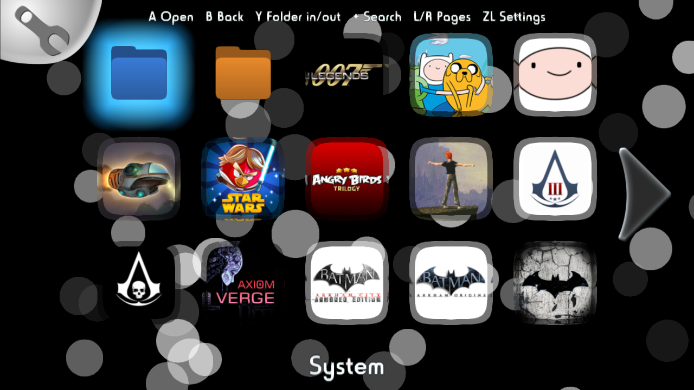
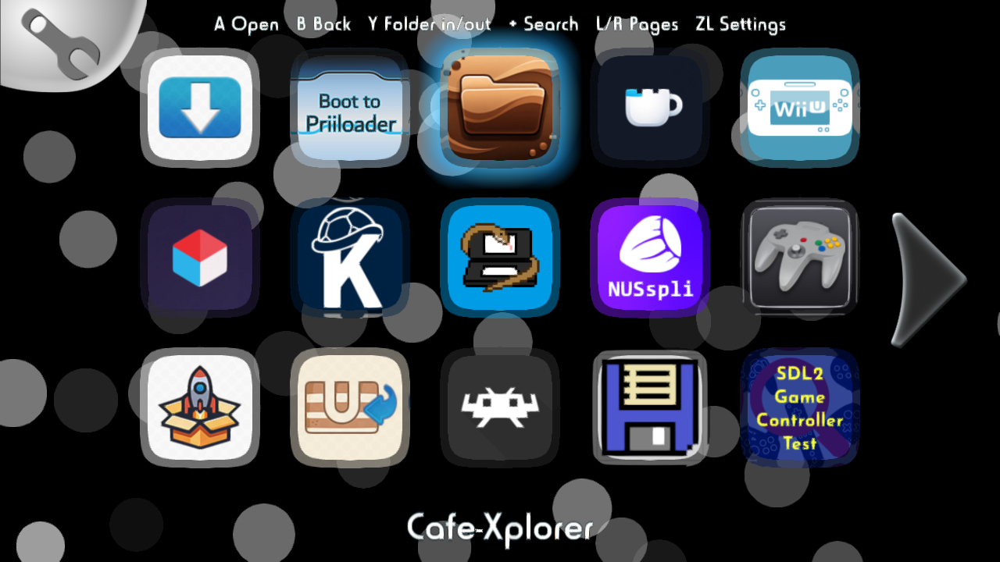
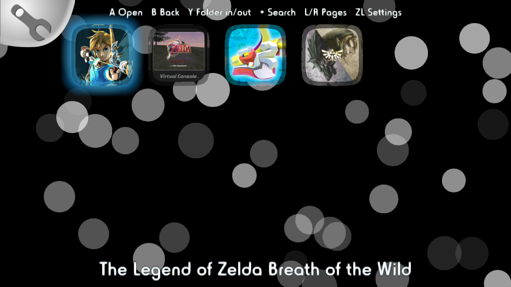
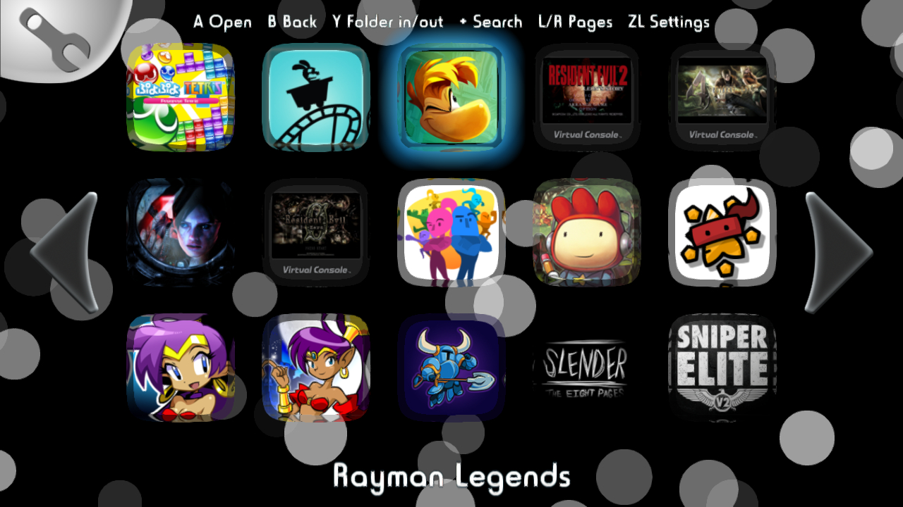

## Launchiine (community continuation, v0.3 beta)

A Wii U Menu replacement for [Aroma](https://aroma.foryour.cafe/), based on [launchiine by Maschell](https://github.com/wiiu-env/launchiine).
The original was published as an unfinished work in progress; this fork picks it up and makes it usable day to day.

> **Beta.** It has been tested on one console with ~190 titles (Wii U games, Virtual Console, Wii injects and 30+ homebrew apps).
> Nothing is written to the NAND: deleting `men.rpx` from the SD card brings back the original Wii U Menu.

### Screenshots
| Main grid with the System and Homebrew folders | Homebrew folder |
|---|---|
|  |  |
| **Search ("zelda")** | **Alphabetical order, page arrows** |
|  |  |

### What changed compared to the original
**Looks like the Wii U Menu** (all graphics are new drawings, no Nintendo files are included)
- Light theme with glass tiles, cyan selection with a *Start* band, name bubble over the selected icon.
- Neighbouring pages peek in at the screen edges, big white page arrows, page dots.
- Folders with a grid icon and their name, a colored background inside, name bar, folder settings (wrench) and back tab.
- Dialogs with a white panel, dark header and glossy buttons.
- The TV is rendered at the console resolution (1080p when set).

**Works like a day-to-day menu**
- **Stability:** fixed the random freezes and crashes (threading in the icon loader, GPU commands sent from a second thread,
  GUI objects deleted on another thread, file reads overwriting neighbouring memory, a hang on exit).
- **Gamepad and touch controls:** D-pad / left stick / touch to select, A or a tap on the selected icon to start, L/R to change pages.
- **Alphabetical order** by full name, system apps first.
- **Folders:** fixed *System* and *Homebrew* folders plus your own folders (create, move titles, rename, delete, change color).
- **Homebrew:** `.rpx` / `.wuhb` apps from `sd:/wiiu/apps` show up and start like in the original menu
  (needs the [homebrew_on_menu](https://github.com/wiiu-env/homebrew_on_menu_plugin) plugin, included in Aroma).
- **Search** (+ button): matches words in the short and the full name, ignores case, accents and punctuation,
  also finds titles inside folders.
- **Accounts (experimental):** the current user's Mii in the corner, X opens the user picker, asks at boot without a default account.
- **Game update notice:** titles with a newer update on Nintendo's servers get an orange badge and *Update available*.
- **Fast start:** names and icons are cached on the SD card; the menu is complete in well under a second.
- The menu opens on the last started title (inside its folder if needed).
- Names follow the console language.
- ZL opens System Settings.

### Installation
1. Download the latest release from the [Releases page](https://github.com/vbarros22/launchiine/releases).
2. Extract `launchiine-<version>.zip` to the root of the SD card, or copy `men.rpx` to `sd:/wiiu/environments/aroma/men.rpx`.
3. Start the console as usual; launchiine shows up instead of the Wii U Menu.

Development builds of every commit are available as the `men-rpx` artifact in the Actions tab.

To go back to the original menu, delete (or rename) `men.rpx`.

### Controls
| Button | Action |
|---|---|
| D-pad / left stick / touch | Select |
| A (or tap the selected icon) | Start the title / open the folder |
| B (or the back tab) | Leave the folder / close a dialog |
| Y | Move the selected title (to a folder, the main grid or a new folder); on a folder: folder settings |
| + | Search (empty search shows everything again) |
| X (or tap the Mii) | Choose the user |
| L / R | Previous / next page |
| ZL | System Settings |

### Files on the SD card
Everything lives in `sd:/wiiu/launchiine/` and can be deleted at any time:
- `names.txt` – cached title names (rebuilt automatically)
- `icons.bin` – cached icons (rebuilt automatically)
- `updates.txt` – latest update versions from the last check
- `lastTitle.txt` – last started title
- `folders.txt` – your folders, their colors and which titles were moved

### Known limitations
- Account switching has only been tested with a single account.
- Updates are only announced; download them through the original menu or System Settings.
- Quick Start Menu and external storage handling rely on Aroma's [AutobootModule](https://github.com/wiiu-env/AutobootModule).
- No Wara Wara Plaza / TV view; the TV mirrors the grid.
- No menu music or splash sound from the original menu.
- There is no way to open the original Wii U Menu from launchiine yet (delete `men.rpx` instead).
- Leaving System Settings or Wii titles reboots the system and Aroma has to load again; that takes a moment, like with the original menu.

### Reporting problems
Launchiine logs over the network (UDP port 4405, the usual Aroma logging). Please attach the log when reporting a freeze.
A PowerShell one-liner that receives and saves it:
```
$u = New-Object System.Net.Sockets.UdpClient 4405; $ep = New-Object System.Net.IPEndPoint ([System.Net.IPAddress]::Any, 0); while ($true) { $l = [Text.Encoding]::UTF8.GetString($u.Receive([ref]$ep)); $l; Add-Content "$env:USERPROFILE\Downloads\launchiine-log.txt" $l }
```
Builds made with `make VERBOSE=1` additionally log every title, texture and a render heartbeat.

### Building
With Docker (nothing else needed on the host):
```
# Build docker image (only needed once)
docker build . -t launchiine-builder

# make
docker run -it --rm -v ${PWD}:/project launchiine-builder make

# verbose logging build
docker run -it --rm -v ${PWD}:/project launchiine-builder make VERBOSE=1

# make clean
docker run -it --rm -v ${PWD}:/project launchiine-builder make clean
```
Without Docker: install [wut](https://github.com/devkitPro/wut) and [libgui](https://github.com/wiiu-env/libgui), then run `make`.

### Credits
- [Maschell](https://github.com/Maschell) – original launchiine, Aroma, Mocha, libgui and most of the Wii U homebrew environment
- Dimok – the original libgui / GUI code this is built on
- Continuation: vbarros22, developed with AI assistance (Claude by Anthropic) and tested on a real console
